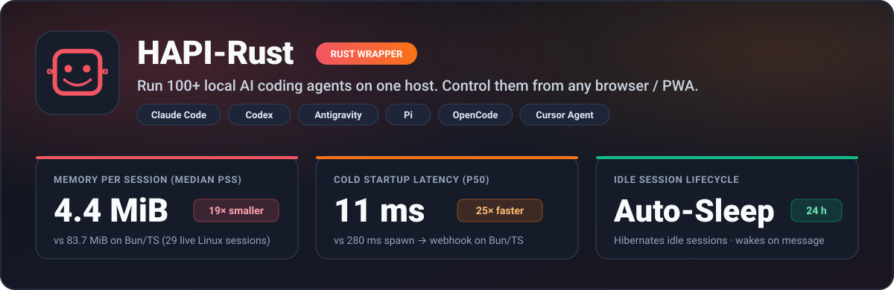
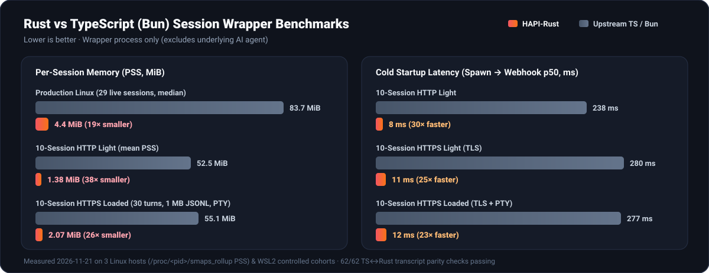
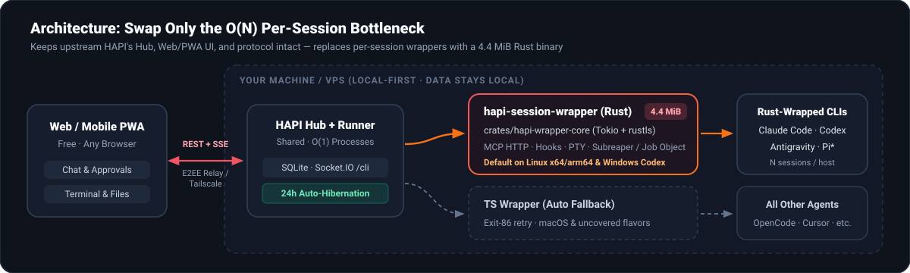

<p align="center">
  <a href="https://overbaker.github.io/hapi-rust/">
    
  </a>
</p>

<p align="center">
  <a href="https://github.com/Overbaker/hapi-rust/releases/latest"></a>
  <a href="LICENSE"></a>
  <a href="https://github.com/Overbaker/hapi-rust/issues?q=is%3Aissue+is%3Aopen+label%3A%22good+first+issue%22"></a>
  <a href="https://github.com/Overbaker/hapi-rust/issues?q=is%3Aissue+is%3Aopen+label%3A%22help+wanted%22"></a>
</p>

<p align="center">
  <a href="https://overbaker.github.io/hapi-rust/"><strong>Docs</strong></a> ·
  <a href="https://overbaker.github.io/hapi-rust/guide/rust-wrapper"><strong>Benchmarks</strong></a> ·
  <a href="https://github.com/Overbaker/hapi-rust/releases/latest"><strong>Downloads</strong></a> ·
  <a href="CONTRIBUTING.md"><strong>Contribute</strong></a> ·
  <a href="https://github.com/Overbaker/hapi-rust/discussions"><strong>Discussions</strong></a>
</p>

---

**HAPI-Rust** is a local-first remote controller and **4.4 MiB Rust session wrapper** for **Claude Code, OpenAI Codex, Antigravity, Pi, OpenCode, and Cursor Agent** — forked from [tiann/hapi](https://github.com/tiann/hapi) (which stays TypeScript-only per [tiann/hapi#2534](https://github.com/tiann/hapi/issues/2534)) so one Linux or Windows machine can keep **100+ AI coding sessions** open with **24 h auto-hibernation** and free Web/PWA control. *(Unrelated to Houdini Engine's `hapi-rs` crate.)*

## Benchmarks

<p align="center">
  
</p>

<details>
<summary><strong>View full measured tables (29 live Linux sessions + 10-session controlled cohorts)</strong></summary>

#### Real-World Production Memory (2026-11-21 · 29 Live Sessions · 3 Linux Hosts · Wrapper PSS)

| Wrapper Runtime | Live Sessions | Median PSS | Range |
|---|---:|---:|---:|
| **Rust** (`claude`, `codex`, `agy`) | 10 | **4.4 MiB** | 2.2–6.5 MiB |
| **TypeScript / Bun** (`claude`, `codex`, `agy`, `pi`) | 19 | **83.7 MiB** | 45.8–242.0 MiB |

#### Controlled 10-Session Comparison (Linux/WSL2 · RSS / PSS / USS & Startup p50/p95)

| Cohort | Sessions | Compiled TS (RSS / PSS / USS) | Rust (RSS / PSS / USS) | Startup p50/p95 (TS → Rust) |
|---|---:|---:|---:|---:|
| HTTP light, single | 1 | 98.6 / 95.9 / 95.7 MiB | **7.3 / 5.3 / 5.2 MiB** | — |
| HTTP light | 10 | 97.8 / 52.5 / 48.1 MiB | **7.2 / 1.38 / 0.89 MiB** | 238/246 ms → **8/11 ms** |
| HTTPS light | 10 | 98.9 / 52.5 / 47.9 MiB | **8.2 / 1.73 / 1.19 MiB** | 280/290 ms → **11/14 ms** |
| HTTPS loaded (30 turns, ~1 MB JSONL, 1 live PTY) | 10 | 101.7 / 55.1 / 50.5 MiB | **8.6 / 2.07 / 1.53 MiB** | 277/291 ms → **12/15 ms** |

</details>

## Architecture

<p align="center">
  
</p>

## Quick Start

Download `linux-x64`, `linux-arm64`, or `windows-x64` from [**Latest Release**](https://github.com/Overbaker/hapi-rust/releases/latest) and keep `hapi` + `hapi-session-wrapper` in the **same `bin` directory**. *(Upstream npm `@twsxtd/hapi` has no Rust wrapper.)*

```bash
hapi hub --relay   # start local hub with E2E encrypted WireGuard + TLS relay
hapi claude        # or: hapi codex (uses Rust wrapper automatically)
```

| Switch | Default | Purpose |
|---|---|---|
| `HAPI_RUST_WRAPPER_FLAVORS` | all supported | Restrict flavors (e.g. `claude,codex`) or `none` for TS everywhere |
| `HAPI_SESSION_HIBERNATE_MS` | `86400000` (24 h) | Auto-hibernate idle sessions (`0` disables · manual: `hapi hibernate --help`) |

<details>
<summary><strong>Build from source (Bun 1.4.4 + Rust stable)</strong></summary>

```bash
git clone https://github.com/Overbaker/hapi-rust.git && cd hapi-rust
bun install && bun run build:single-exe
cargo build --release -p hapi-session-wrapper
```

</details>

## Fork Diff & Platforms

| | **HAPI-Rust** (`Overbaker/hapi-rust`) | Upstream (`tiann/hapi`) |
|---|---|---|
| **Session wrapper** | **Rust** (`claude`, `codex`, `agy`, `pi` exp.) + TS auto-fallback | TypeScript (Bun) |
| **Wrapper RAM / start** | **4.4 MiB** median · **11 ms** cold start | 83.7 MiB · 280 ms |
| **Idle sessions** | **24 h auto-hibernate**, wake on next message | Stay running |
| **Platforms (Rust)** | Linux x64/arm64 (`claude`, `codex`, `agy`, `pi`*) · Windows x64 (`codex`) · TS fallback elsewhere | TS everywhere |
| **Token usage page** | Every namespace sees its own sessions and machines | Hub owner (`default` namespace) only |
| **Clients** | Free **Web / PWA** only (native mobile app code/promotion removed) | Web / PWA + paid iOS/Android |

## Contributors & Co-Maintainers Wanted

Run `cargo test --workspace` and `bun run test:parity` offline **without paid LLM API keys**. See [CONTRIBUTING.md](CONTRIBUTING.md).

| Track | Open Issues |
|---|---|
| **Good First Issues** | [#15](https://github.com/Overbaker/hapi-rust/issues/15) JSON depth · [#16](https://github.com/Overbaker/hapi-rust/issues/16) `O_NOFOLLOW` open · [#17](https://github.com/Overbaker/hapi-rust/issues/17) MCP HTTP task · [#27](https://github.com/Overbaker/hapi-rust/issues/27) CI PTY timeout |
| **macOS & Windows** | [#21](https://github.com/Overbaker/hapi-rust/issues/21) Apple Silicon / Intel CI & Windows Claude/Pi |
| **Claude & MCP Parity** | [#25](https://github.com/Overbaker/hapi-rust/issues/25) Rewind / fork-at-message · [#26](https://github.com/Overbaker/hapi-rust/issues/26) dynamic MCP `link_pr` |
| **Process Lifecycle & Flavors** | [#23](https://github.com/Overbaker/hapi-rust/issues/23), [#24](https://github.com/Overbaker/hapi-rust/issues/24) subreaper/cgroup · DeepSeek Harness / OpenCode / Cursor Agent |

<details>
<summary><strong>FAQ</strong></summary>

- **How is HAPI-Rust different from `tiann/hapi`?** Same hub, Web/PWA, and protocol — replaces the per-session Bun/TS wrapper with a 4.4 MiB Rust binary, adds 24 h auto-hibernation, and focuses purely on Web/PWA.
- **Can one host run 50–100+ Claude Code / Codex sessions?** Yes — 100 Rust wrappers take a few hundred MiB total instead of 8–20+ GiB, and idle sessions auto-hibernate after 24 h.
- **What if a feature isn't in Rust yet?** Automatic exit-86 fallback to the TypeScript wrapper (or set `HAPI_RUST_WRAPPER_FLAVORS=none`).
- **Does it work on macOS?** Yes via automatic TS fallback today; native macOS Rust builds are tracked in [#21](https://github.com/Overbaker/hapi-rust/issues/21).

</details>

---

Built on [tiann/hapi](https://github.com/tiann/hapi) (**AGPL-3.0**). HAPI ("哈皮") is a transliteration of [Happy](https://github.com/slopus/happy).
